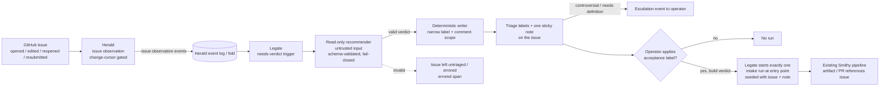

# RFC: Issue Triage into Smithy Entry Points

**Created**: 2026-11-19  |  **Status**: Draft

## Summary
<!-- audience: stakeholder; mode: explanation; length: 2-3 sentences; diagram: optional; examples: discouraged -->

This RFC gives every open issue in every repository March manages a recorded, visible triage verdict. The verdict names either the Smithy entry point where the work should start (`spark`, `ignite`, `render`, `mark`, or `strike`) or a non-build outcome (*needs definition*, *controversial*, or *close*), and the operator decides whether to act on it. Without this, the backlog gets re-triaged by hand on every visit, and the issues that do get worked skip the planning pipeline March was built to run, taking a direct-prompt path that needs more rework.

## Motivation / Problem Statement
<!-- audience: stakeholder; mode: explanation; length: 2-3 paragraphs; diagram: optional; examples: discouraged -->

The March repository has 63 open issues and smithycli has 33, and nothing in the tracker says which of them have been looked at or what each one needs. The only labels in use are `bug`, `enhancement`, and `area:*`, and many recent issues have no label at all. Issues come from three places: the operator, March's own agents filing `automated` reports, and outside contributors. They vary widely. One is a one-line patch, the next is an RFC-sized idea, another is too vague to act on, and some should just be closed. None of those distinctions get written down, so each time the maintainer opens the backlog they start triage over from nothing, in every profile March runs. Authors see no answer either. A contributor whose issue is too thin to act on never hears that it needs more definition, or why.

The bigger cost comes after an issue is picked up. March now takes Smithy planning artifacts (PRD, RFC, feature map, spec, tasks) all the way to merged PRs without help, but issues are not an input to that pipeline. Nothing turns "an issue exists" into "a Smithy artifact at the right scale exists." So the maintainer usually writes a prompt for the issue by hand, which skips the planning stages March exists to automate. The maintainer's own analysis (Balexda/March-Private#2) found that this direct-prompt path produces lower-quality code and needs rework more often than the same work done through Smithy. The backlog keeps growing, and the work that does get done goes down the path that needs the most fixing afterward.

This has to be fixed now because the planning pipeline is already autonomous and issues are the main input it can't take. Each issue worked by hand is quality March could have delivered and didn't. March's own agents are now filing issues too, so the backlog grows without the operator doing anything. The goal is a tracker where every open issue shows whether it has been reviewed, what the outcome was, and where its work should start. Accepted issues then flow into the same pipeline as all other planned work, and authors can see why their issue went where it did.

## Goals
<!-- audience: reviewer; mode: reference; length: tables only; diagram: optional; examples: discouraged -->

- **No untriaged backlog.** Every open issue in every registered profile's repository (at least march and smithycli) shows its triage state. The number of open issues with no triage state falls to near zero and stays there. New issues are covered automatically. A newly registered profile needs no extra setup. A removed profile stops being triaged.
- **One verdict from a fixed vocabulary.** Each triaged issue carries exactly one recommended outcome and exactly one confidence (high, medium, or low). The outcome comes from a versioned vocabulary shared by all repositories: the build outcomes `spark`, `ignite`, `render`, `mark`, `strike`, or the non-build outcomes *needs definition*, *controversial*, *close*. `cut`, `forge`, and anything outside the vocabulary are never accepted as a verdict. Questions and support requests resolve to *close* or *needs definition*.
- **Labels are the visible record.** Triage state, outcome, and confidence are GitHub labels that sit beside the existing `bug`, `enhancement`, and `area:*` labels without replacing them. Labels are the authoritative current state. Any operator shortcut can be reproduced by editing labels by hand.
- **The author's text is never touched.** Each issue gets at most one triage note, which is updated in place. The note carries any added repository context and, for *needs definition*, a grade and explanation written to a published tone standard. That gives every author a readable reason for where their issue went. The issue's title and body are never edited or deleted.
- **Triage only recommends.** Nothing is dispatched or closed because of a verdict alone. The operator accepts a build verdict with an explicit acceptance label. *Close*, *controversial*, *needs definition*, and unaccepted verdicts never start work.
- **Accepted issues enter the Smithy pipeline.** Accepting a build verdict starts exactly one run at the recommended entry point, seeded with the issue and its note. Re-accepting never starts a second run. The resulting artifact or PR links back to the issue, and when the first Smithy artifact from that run merges, the issue closes with its triage note pointing at that artifact, so the work stays traceable from the issue. The small-patch (`strike`) path replaces today's hand-written issue prompt (`legate.issue`), so the maintainer stops writing prompts for routed issues.
- **Verdicts arrive in bounded time and are never permanent.** New issues get a verdict within one hour of being opened. An issue re-enters triage when its content changes, when it is reopened, or when it is explicitly resubmitted. March's own writes, comment-only activity, and agent-filed `automated` issues never cause a re-triage loop. A label the operator changed stays until the issue's content changes. A new rubric version does not trigger mass re-triage.
- **Safe to run unattended.** Issue text is treated as untrusted input. The judgment step is read-only. Its output is checked against a schema, and invalid output is rejected. One deterministic writer is the only component that writes to GitHub, and it writes only labels and the triage note, using the narrowest per-repository access. A failed run leaves the issue visibly untriaged or errored, never half-labeled. Each trigger and its run can be followed end to end in one trace.
- **Escalations and judgment quality are visible.** *Controversial* and *needs definition* verdicts reach the operator as escalations without blocking any automated component. The operator can see them without opening GitHub. The untriaged count, time-to-verdict, the escalation queues, and how often the operator overrides a verdict (by outcome and by confidence) are all measurable.
- **Trust is measured before triage runs continuously.** The recommender's agreement with the operator is measured on a reference set drawn from the march and smithycli backlogs. That measurement sets what counts as high confidence, and it is recorded before triage runs continuously.
- **Ships in the open engine.** The rubric, vocabulary, and recommender ship in this repository, as decided in the PRD (SD-002). This is recorded as an exception to the open-core boundary, with a defined seam where a future plugin could take over the judgment.

## Out of Scope
<!-- audience: reviewer; mode: reference; length: tables only; diagram: optional; examples: discouraged -->

- **Changing Smithy stages or forge.** Triage routes issues into Smithy's existing entry points. It does not add, remove, or modify any Smithy stage, and it does not change how `cut` or `forge` work.
- **Triaging pull requests.** Only issues are observed and triaged. PRs are excluded.
- **Priority or scheduling.** Triage says where work should start, not when or in what order. Ranking and scheduling beyond what March already dispatches are not covered.
- **Trackers other than GitHub.** Linear, Jira, and other issue trackers are not supported.
- **Rewriting or deleting the author's issue text.** Added context lives only in the triage note. Editing or deleting the title or body is never done, including to "improve" an issue.
- **Dispatching or closing without operator acceptance.** No verdict starts work or closes an issue on its own, whatever its confidence. An issue closes only after the operator has accepted it and the first Smithy artifact from the resulting run has merged.
- **Measuring rework against the private baseline.** Comparing rework on triaged work with the direct-prompt baseline in Balexda/March-Private#2 is a follow-up effort. This RFC only provides the signals that comparison would need: provenance links, override history, and triage metrics.

## Personas
<!-- audience: stakeholder; mode: reference; length: tables only; diagram: optional; examples: discouraged -->

- **The maintainer/operator.** The one person running March across several registered profiles (march, smithycli, and others). Right now they re-triage an unlabeled backlog by hand every time they open it, then write a prompt for each issue they pick up, which skips the Smithy planning stages. With this RFC, every open issue carries a visible verdict naming its Smithy entry point or a non-build outcome. Accepting a build verdict is one explicit label (or `accept` in the CLI), and that starts exactly one run, seeded with the issue and its triage note. The operator stays in charge of the decision without having to triage from scratch.
- **March's legate.** The downstream machine consumer that turns planned work into merged PRs. Today issues aren't one of its inputs: nothing it can read says which Smithy entry point an issue belongs at, or whether anyone has approved working on it. This RFC gives it a schema-validated, machine-readable verdict plus an unambiguous acceptance signal, so it starts work only on accepted build verdicts. Unaccepted, close, controversial, and needs-definition issues never start a run.
- **Issue authors.** The operator, March's own agents filing `automated` issues, and outside contributors. Today an author whose issue is too thin to act on never hears that, or why. With this RFC, each author sees one sticky triage note on their issue. It gives the verdict and the reasoning, including a needs-definition grade written to a published tone standard, and it never edits the author's text. Editing, reopening, or explicitly resubmitting a needs-definition issue sends it back through triage, so authors have a clear way forward.

## Proposal
<!-- audience: reviewer; mode: explanation; length: 3-6 paragraphs; diagram: recommended; examples: recommended -->

March already has nearly everything triage needs except the judgment. Herald observes repositories, the legate decides what to dispatch, GitHub labels give a shared record that people can see, and Smithy runs planning artifacts through to merged PRs. This RFC adds no new service. It lets Herald observe **issues** as well as PRs, has the legate notice when an open issue needs a verdict and start one judgment run for it, and records the result as GitHub labels plus a single sticky triage note on the issue. Labels in a dedicated triage namespace hold the current state. That namespace covers triage state, outcome, confidence, and an operator acceptance label, and it sits beside the existing `bug`, `enhancement`, and `area:*` labels without replacing them. Herald's event log keeps the history of what was observed.

Each run is split in two. A **read-only recommender** reads the issue as untrusted input, along with whatever repository context the rubric allows, and returns a structured verdict: an outcome from the versioned vocabulary, a confidence, a rationale, and for *needs definition* a grade with an explanation. The output is checked against a schema, and anything that fails the check, including `cut`, `forge`, or any outcome outside the vocabulary, is rejected. A failed run leaves the issue visibly untriaged or errored. Only after the verdict passes does a **deterministic writer** act on it. The writer is the one component allowed to change anything on GitHub, and it can only set triage labels and create or update the triage note. It writes the same way every time, so running it again on an unchanged issue changes nothing.

Triage only recommends. The operator accepts a build verdict by adding the acceptance label; the CLI `accept` command just applies that same label. The legate treats the accepted label as an intake signal and starts **exactly one** run at the recommended Smithy entry point (`spark`, `ignite`, `render`, `mark`, or `strike`), seeded with the issue and its note. That run has its own stable issue-intake identity, so accepting an issue again never starts a second run. From there the work follows the existing pipeline. The resulting planning artifact or PR joins the dispatch graph like any other planned work and links back to the issue it came from. *Close*, *controversial*, *needs definition*, and unaccepted verdicts never start a run. *Controversial* and *needs definition* go to the operator as escalations through Herald events, and no automated step waits on them.

Here is a triaged small-patch issue as an example. Its labels might read `bug`, `area:herald`, `triage:triaged`, `triage:strike`, `triage:confidence-high`. The note under it would say something like: *"Triage verdict: **strike** (high confidence). This is a one-line guard in the profile listing path with an obvious test; no planning artifact is warranted. Accept with `triage:accepted` to start a small-patch run."* A hidden marker in the note records the rubric version, the issue's content hash at the time, the original verdict, and any repository context that was added. A *needs definition* note would instead give a grade and say, in the published tone standard, what is missing. Neither note ever touches the author's title or body. The exact label names come from the triage contract; these are illustrative.

Re-entry is driven by what the issue says, not by activity on it. An issue goes back through triage when its content hash changes, when it is reopened, or when someone explicitly resubmits it. Comments alone, March's own label and note writes, and agent-filed `automated` issues never trigger it. A label the operator changes by hand stays until the issue's content changes. A new rubric version is recorded in later notes but does not cause a mass re-triage. An operator-run backfill clears the existing march and smithycli backlogs before continuous triage starts. That backfill also measures how often the recommender agrees with the operator on a reference set, and the result sets what "high confidence" means.

## Design Considerations
<!-- audience: reviewer; mode: explanation; length: 3-6 paragraphs; diagram: optional; examples: discouraged -->

**Labels are the authority, Herald is the history.** Herald's fold is March's event-sourced source of system state, so making GitHub labels authoritative for triage is a deliberate exception, and it is the most consequential choice in this RFC. Triage state is something the operator edits by hand in the GitHub UI, and the goals require that every CLI shortcut can be reproduced by editing labels. If the fold were authoritative, hand edits would have to be reconciled back into it. So Herald observes label changes as low-cardinality issue events and keeps them as history; the fold mirrors the current state and does not own it. Override detection compares the original verdict stored in the note's hidden marker with the label-change history Herald saw. The cost is that the two views can briefly disagree between ticks; in that window the labels win and the fold catches up. New event types still go through the shared event taxonomy and the `POST /events` validator, under the rule that event types stay low-cardinality.

**Judgment and actuation are split, and that requires new write access.** Today the forge seam asks Tessera only for read access, and no March path writes to issues. Triage needs a new, narrow write capability: per-repository, limited to labels and issue comments, and declared on a typed interface under operating-philosophy Rule 2 (minimum required access). It goes to the deterministic writer only, never to the recommender. Issue text is untrusted and can carry prompt injection. Keeping the language-model step read-only, validating its output against a schema, and failing closed means the worst a malicious issue can do is produce a wrong, schema-valid verdict on itself; it cannot cause arbitrary writes. A failed run leaves a visibly errored issue and an errored span (Rule 3), and the trigger and the run share one trace. The writes go out under the same GitHub identity PRs are opened under, so the writer needs no extra account or app. Because that identity is shared with the stewards and the operator, March cannot tell its own triage writes apart by author; the content-hash re-entry rule is what keeps those writes from re-triggering triage.

**Re-entry follows a content hash, and observation is paid for in call count.** `updatedAt` changes on every comment, label edit, and reaction, including March's own writes. If re-entry keyed on it, every triage write would trigger the next triage. Re-entry therefore uses a hash of the issue's title and body, plus reopen and the explicit resubmit signal. Herald observation follows the existing GraphQL discipline: on GitHub, cost tracks the number of calls rather than the size of each call, so a change cursor gates any per-issue detail fetch, quiet ticks make no per-issue calls, and repositories with issues turned off are skipped. Each issue's model cost and run rate are capped separately, and that cap, together with Herald's tick cadence, must fit inside the one-hour time-to-verdict target.

**What an entry point means, especially for `render` and `mark`.** An entry point is defined as "invoke that Smithy command with the issue and its note as freeform input." For `spark`, `ignite`, and `strike` that matches how those commands already take input. `render` and `mark` normally consume an upstream artifact (an RFC or a feature map), not a free-text issue. This RFC keeps both in the vocabulary and requires intake to check, up front, that each entry verb accepts freeform issue input. A verb that fails the check gets a documented mapping (for example ignite, then render) or a seed-only handoff. No Smithy stage is changed. Scale boundaries are fuzzy, especially between `render`, `mark`, and `strike`, and confidence plus operator acceptance exist to absorb that.

**The legate's dispatch set gets wider; Smithy does not change.** The legate currently dispatches only `render`, `mark`, `cut`, and `forge` from Smithy status records. Accepted-verdict intake adds `spark`, `ignite`, and `strike` as intake-only entry dispatches with their own stable issue-intake slice identity, since an issue is not yet a Smithy record. Per-profile merge policy already knows those verbs as task types. Once the intake artifact exists, it joins the existing graph and is dispatched as usual. The `strike` intake path replaces `legate.issue`, the current hand-written issue prompt; keeping both would give issues two routes into the code with different provenance and different closing behavior. The issue closes when the first Smithy artifact from its intake run merges (the planning-artifact PR for `spark`, `ignite`, `render`, or `mark`; the patch PR for `strike`), and the triage note is updated to link that artifact so later work can be traced from the issue.

**Open-core exception and seam.** Under [`docs/open-core-boundary.md`](../../open-core-boundary.md), agentic judgment would normally sit on the private side. PRD SD-002 decides that the rubric, vocabulary, and recommender ship in the open engine, and this RFC records that as an explicit exception. The seam is the schema-validated verdict contract between the recommender and the deterministic writer. A future plugin could supply a different recommender behind that contract without changing observation, the writer, the labels, or intake, and the open stack stays runnable with the default recommender.

## Decisions
<!-- audience: reviewer; mode: explanation; length: 1-3 paragraphs; diagram: optional; examples: discouraged -->

- **Triage only recommends.** A verdict never dispatches work or closes an issue by itself. The operator settled this in the PRD (SD-001), so a wrong verdict costs one label and one note, not misdirected work.
- **The judgment ships in the open engine.** The rubric, vocabulary, and recommender live in this repository even though `docs/open-core-boundary.md` places agentic judgment in the private layer. The operator settled this in the PRD (SD-002): Smithy is public and there is no plugin mechanism yet. The RFC records it as a named exception and keeps the recommender behind a seam a future plugin can take over.
- **No new service.** Herald observes issues, the legate decides when an issue needs a verdict, and a narrow forge write path puts the result on GitHub. A GitHub Action runner (claude-code-action or gh-aw) was rejected because it needs a workflow and secrets in every profile repository, cannot follow Herald's profile registry, and runs outside March's tracing.
- **Labels are the current state, Herald keeps the history.** GitHub labels are authoritative, as the PRD requires, so a hand edit by the operator always wins. Herald records label changes as observations, which together with the original verdict stored in the triage note makes override rate measurable without a second source of truth.
- **Judgment is split from writing.** The recommender reads untrusted issue text, holds no write access, and must produce schema-valid output or fail closed. A single deterministic writer is the only component that touches GitHub, and it is limited to the triage labels and the triage note. This contains prompt injection from outside contributors, following operating-philosophy Rule 2.
- **Acceptance is an explicit label.** The operator accepts a build verdict by applying an acceptance label. The CLI `accept` verb only applies that label. A label is durable, visible to authors, observable by Herald, and reproducible by hand.
- **Acceptance starts exactly one run.** An accepted build verdict causes the legate to start one run at the recommended entry point, seeded with the issue and its note. This widens the legate's dispatch set beyond `render`/`mark`/`cut`/`forge`. That is a legate change, not a Smithy change, so it stays inside the PRD's scope. If an entry verb cannot take the issue as freeform input, a documented mapping (for example ignite, then render) or a seed-only handoff is used instead of dropping the outcome.
- **Re-entry is keyed on content, not activity.** An issue re-enters triage when a hash of its title and body changes, when it is reopened, or when it is explicitly resubmitted. All three apply to *needs definition*. `updatedAt` alone is never a trigger, because triage's own label and note writes move it.
- **One sticky note per issue.** The triage note is a single comment updated in place, never an edit to the author's text. A hidden marker in it carries the rubric version, content hash, and original verdict. Grades on *needs definition* follow a published tone standard because they are public to outside contributors.
- **Calibration lives with the recommender, and there is no shadow mode.** The high-confidence threshold is set by measured agreement with the operator on a reference set from the march and smithycli backlogs, recorded before triage runs continuously. Operator-invoked runs are the gate. A shadow mode is kept only as an optional fallback if agreement comes in low.
- **`legate.issue` is superseded.** The accepted-`strike` path replaces the existing hand-prompt issue skill, so the two do not run side by side.
- **The issue closes when its first Smithy artifact merges.** Once the operator accepts a build verdict, merging the first artifact from that run closes the issue, and the triage note is updated to point at the merged artifact. Later pipeline stages are traced from that artifact rather than from the issue. Closing still depends on operator acceptance, so no verdict closes an issue by itself.
- **Triage writes use the PR identity.** Labels and notes are written under the same GitHub identity PRs are opened under. This needs no new account or GitHub App. The cost is that triage writes cannot be filtered by author, which re-entry keyed on content already covers.
- **Time-to-verdict is one hour.** A new issue should have a verdict within an hour of being opened. Per-issue cost and rate caps and Herald's tick cadence are sized to fit that target.
- **Rework analytics stay outside this RFC.** The comparison against the private March-Private#2 baseline needs private data. This RFC only supplies the signals it would use: provenance links, override history, and triage metrics.

## Specification Debt
<!-- audience: reviewer; mode: reference; length: index table + 1-3 sentences per item; diagram: optional; examples: discouraged -->

_None — no specification debt was recorded._

## Milestones
<!-- audience: reviewer; mode: reference; length: tables only; diagram: optional; examples: discouraged -->

### Milestone 1: Triage Contract

**Description**: Defines the shared contract every later milestone builds on, so the recommender, observer, operator surface, and intake all read and write the same vocabulary and labels. It realizes the *one verdict from a fixed vocabulary*, *labels are the visible record*, *the author's text is never touched*, and *ships in the open engine* goals. It covers:
- **Outcome vocabulary.** Versioned and kept in the open repository. Build outcomes are `spark`, `ignite`, `render`, `mark`, and `strike`; non-build outcomes are *needs definition*, *controversial*, and *close*. `cut` and `forge` are never valid.
- **Labels.** A label namespace for triage state, outcome, and confidence that sits beside the existing `bug`, `enhancement`, and `area:*` labels, plus an explicit acceptance label and an explicit resubmit signal.
- **Triage note.** One sticky triage note per issue. A hidden marker in it records the rubric version, the content hash the verdict was made against, the original verdict, any added repository context, and the needs-definition grade. The issue's title and body are never edited.
- **Grading and tone.** A needs-definition grade scale and a published tone standard for public grades.
- **Ownership.** Which labels belong to triage and which to the operator. GitHub labels are the authoritative current state; Herald's fold only mirrors them.
- **Entry-point meaning.** A build verdict means "invoke this Smithy command with the issue and its note as freeform input". The contract states explicitly what `render` and `mark` mean as issue entry points.
- **Fallbacks and existing paths.** Questions and support issues resolve to *close* or *needs definition*. `legate.issue` is declared superseded by the `strike` intake path.
- **Open-core exception.** The exception to the open-core boundary (PRD SD-002) is recorded with the seam where a future plugin could take over the judgment.

**Success Criteria**:
- Label provisioning against every registered profile's repository (at least march and smithycli) creates the full triage label set, and a second run changes nothing.
- The verdict schema rejects `cut`, `forge`, any outcome outside the vocabulary, a missing confidence, and more than one outcome, each with a test fixture.
- Every outcome, confidence level, re-entry trigger, acceptance signal, and resubmit signal in the PRD maps to exactly one named contract element, traceable by a reviewer.
- The marker carries a rubric version field, so a verdict can be attributed after the rubric changes.
- The open-core exception and the plugin seam are written into the repository's open-core boundary record.

### Milestone 2: Single-Issue Recommender and Operator Backfill

**Description**: Delivers the judgment and the only path that writes to GitHub. The operator runs it on one issue or as a paced sweep of a profile's backlog; nothing runs continuously yet. Judgment and actuation are separate:
- **Recommender.** Read-only, treats issue text as untrusted input, and its output is validated against the contract schema and rejected if invalid.
- **Writer.** One deterministic writer is the only component that writes to GitHub, through a narrow new forge write surface (forge requests only read access today). The surface is limited per repository to labels and comments, writes idempotently under the same GitHub identity PRs are opened under, and emits an errored span on failure.
- **Calibration baseline.** A reference set drawn from the roughly 96 open march and smithycli issues, with the operator's verdicts as ground truth, yields an agreement score and the high-confidence threshold.

It realizes *safe to run unattended*, *trust is measured before triage runs continuously*, and the backfill half of *no untriaged backlog*.

**Success Criteria**:
- Triaging an issue leaves exactly one outcome label, one confidence label, and one triage note.
- Re-running on an unchanged issue makes zero GitHub writes; re-running after the body changes updates the same note in place.
- A test confirms the writer's only GitHub mutations are triage labels and the triage note: no title or body edits, no closes, no dispatch.
- Injected failures (invalid recommender output, a write error partway through) leave the issue visibly untriaged or errored, never partially labeled, and emit an errored span.
- After backfill, untriaged open issues are near zero in both march and smithycli.
- Agreement on the reference set and the derived high-confidence threshold are recorded before continuous triage is enabled.
- Every run emits one span carrying verdict, confidence, and rubric version.

### Milestone 3: Issue Observation in Herald

**Description**: Herald observes open issues across every registered profile, excluding PRs, and records low-cardinality issue observation events: triage state, content hash, and label changes, so operator overrides leave a history. Herald has no issue events today. This gives the legate the fold input continuous triage needs and the operator surface the history it needs. It realizes the coverage half of *no untriaged backlog* and the measurement half of *escalations and judgment quality are visible*, and runs in parallel with the recommender.

**Success Criteria**:
- Observation is change-cursor gated: on a tick where no issue changed, Herald makes no per-issue GitHub calls.
- Herald publishes a per-profile untriaged gauge and a time-to-verdict metric, with low-cardinality labels and no issue numbers.
- A newly registered profile's issues appear with no extra setup; a removed profile's issues stop being observed.
- Repositories with issues disabled are skipped without error.
- Label changes, including operator overrides, are recorded and readable back as per-issue history.
- No PR ever appears as an issue event.

### Milestone 4: Continuous Triage and Re-entry

**Description**: The legate triggers the recommender for every issue the fold marks as needing a verdict, across the whole profile registry, with each profile isolated so one failing repository cannot stall the others.
- **Re-entry triggers.** A content-hash change, a reopen, or an explicit resubmit. Comment-only activity and March's own writes never trigger a run.
- **Stability.** An operator-changed label stays until the issue's content changes. A new rubric version does not cause mass re-triage.
- **Escalations.** *Controversial* and *needs definition* verdicts emit escalation events that never block an automated component.

It realizes *verdicts arrive in bounded time and are never permanent* and the escalation half of the visibility goal. The target is one hour.

**Success Criteria**:
- New issues get a verdict within one hour, as measured by the time-to-verdict metric.
- Editing an issue's body re-enters it; March's own label and note writes and comment-only activity cause zero re-triage runs (tested).
- An operator-changed label survives every later tick until the issue's content changes.
- A rubric version bump starts no runs for issues whose content hasn't changed.
- Two overlapping runs on one issue still leave exactly one outcome label, one confidence label, and one note.
- A per-issue cap on LLM cost and run rate holds, and an agent-filed `automated` issue cannot start an endless re-triage loop.
- A failure in one profile doesn't stop triage in the others.
- Each trigger and the run it starts appear in one trace.

### Milestone 5: Operator Surface and Escalation Visibility

**Description**: CLI commands to list, show, accept, override, and re-triage issues, each a shortcut over label edits and runnable from a plain npm install. Grafana panels show untriaged count, time-to-verdict, escalation queues, and override rate, computed from the note's original verdict plus Herald's label-change history. It completes *escalations and judgment quality are visible*. Read-only listing and the panels can start once Herald observation lands; accept, override, re-triage, and the escalation queues need continuous triage.

**Success Criteria**:
- *Controversial* and *needs definition* escalations are visible in the CLI and Grafana without opening GitHub.
- Every CLI action has a documented label hand-edit that produces the same result (tested both ways).
- Overrides are countable per verdict and per confidence level.
- The commands run without a source checkout and read no repository or compose files at runtime.
- Panels exist for untriaged count, time-to-verdict, escalation queue depth, and override rate.

### Milestone 6: Accepted-Verdict Intake

**Description**: When the operator applies the acceptance label to a build verdict, the legate starts exactly one run at that entry point, seeded with the issue and its note, under a stable issue-intake slice identity of its own. This widens the legate's dispatch set beyond `render`, `mark`, `cut`, and `forge`; no Smithy stage is modified. `spark`, `ignite`, `render`, and `mark` runs produce a planning-artifact PR that joins the existing Smithy graph, and `strike` replaces the `legate.issue` hand-written prompt. Each entry verb is checked up front for freeform issue input; one that can't take it gets a documented mapping (for example ignite, then render) or seed-only handling. The first increment is operator-triggered acceptance, which needs only the contract and the recommender; continuous pickup of accepted verdicts uses the Herald fold once it is available. It realizes *triage only recommends* and *accepted issues enter the Smithy pipeline*, and produces the provenance links the out-of-scope rework comparison would need. When the first Smithy artifact from the run merges, the issue closes and its triage note is updated to link that artifact.

**Success Criteria**:
- *Close*, *controversial*, *needs definition*, and unaccepted verdicts never start a run (tested per outcome).
- Accepting a build verdict starts exactly one run; re-accepting, or removing and re-applying the label, never starts a second.
- Every resulting artifact or PR links back to its originating issue.
- No Smithy stage changes, and each entry verb's freeform-input handling is checked and recorded before it is enabled.
- Merging the first Smithy artifact from an accepted run closes its issue, and the triage note then links that artifact; no issue is closed by a verdict alone (tested).
- `legate.issue` is no longer the path for routed issues.

## Dependency Order
<!-- audience: builder+ai-input; mode: reference; length: tables only; diagram: optional; examples: discouraged -->

Recommended implementation sequence:

| ID | Title | Depends On | Artifact |
|----|-------|------------|----------|
| M1 | Triage Contract | — | docs/rfcs/2026-003-issue-triage/01-triage-contract.features.md |
| M2 | Single-Issue Recommender and Operator Backfill | M1 | — |
| M3 | Issue Observation in Herald | M1 | — |
| M4 | Continuous Triage and Re-entry | M2, M3 | — |
| M5 | Operator Surface and Escalation Visibility | M4 | — |
| M6 | Accepted-Verdict Intake | M1, M2 | — |
