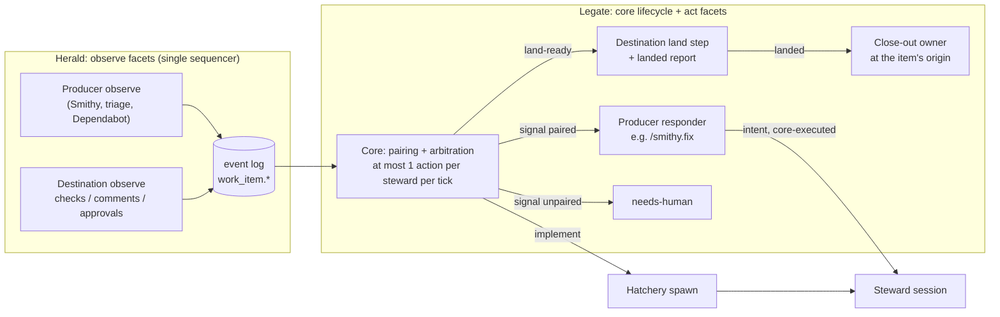

# RFC: Pluggable Work Modules

**Created**: 2026-11-26  |  **Status**: Draft

## Summary
<!-- audience: stakeholder; mode: explanation; length: 2-3 sentences; diagram: optional; examples: discouraged -->

This RFC makes each kind of work March runs (Smithy planning, Dependabot updates, issue triage) a module that plugs into one shared lifecycle, and it gives merge rules to the repository or board where the work lands instead of the flow that produced it. After this change, adding a new kind of work or a new place for work to land is a profile configuration change, not an edit to the legate's core loop. Safety, recovery, teardown and tracing stay in the core.

## Motivation / Problem Statement
<!-- audience: stakeholder; mode: explanation; length: 2-3 paragraphs; diagram: optional; examples: discouraged -->

The maintainer runs March across several profiles and can't add a new kind of work without editing the legate's control loop. Today March handles three kinds of work, and each one is wired into the loop by hand. Smithy planning slices are the largest. The loop itself decides which planning nodes are ready, how each dispatch is named, what each steward is told, and which merge rules apply to each Smithy verb. The steward watchdog alone is about 1,170 lines. Dependabot PRs arrive already open, so they get their own handler of about 500 lines, with its own merge gate, labels and pacing. CodeRabbit re-review has a separate handler of its own. The three flows share no common shape, so every change to one of them, and every new flow, is a change to the core.

Issue triage makes this urgent. Triage ends in a verdict (labels and a sticky note), not a PR. It hands accepted issues to Smithy, and the issue has to be closed when its first artifact merges. No current flow reports back to where the work came from, and the operator estimates that adding triage the current way would grow the code by about 40%. Merge rules have the same misplacement. They are keyed to Smithy verbs inside a profile, but whether an artifact can land is decided by the place it lands, and each place has its own approvals and checks. A Dependabot PR and a Smithy cut in the same repository should face that repository's rules. The coupling also blocks the open-core plan, which keeps enterprise connectors such as Jira private. A private module can't ship if every kind of work has to be written into the open core loop.

The goal: a new kind of work, or a new place for work to land, is added as a module that says what work it picks up, what instructions go with it, and how it responds when something goes wrong. Each repository's landing rules live in one place, whichever module produced the PR, and an issue closes when its first artifact lands. The guarantees March has today stay in the core and no module can bypass them: only non-destructive actions run automatically, teardown stays with the core, and stuck work still recovers. Existing flows move over one at a time, not in a single rewrite.

## Goals
<!-- audience: reviewer; mode: reference; length: tables only; diagram: optional; examples: discouraged -->

| # | Goal | How a stakeholder evaluates it |
|---|------|--------------------------------|
| G1 | **A published, versioned module contract that every module uses, Smithy included.** The contract covers producers, destinations, responders, the work-item model (kind, origin, destination, entry stage, a single close-out owner), the three signal groups (checks, comments, approvals) and a closed step vocabulary. | The contract is exported from the open package and loaded by package specifier. A module built against an incompatible contract version is refused at startup. A fixture module that lives outside the tree runs end to end against the published contract alone. |
| G2 | **A new kind of work or a new landing place is a profile configuration change.** Module bindings live in Herald's profile registry next to the profile's one repo and its destinations. | Adding or removing a module binding needs no edit to the legate coordinator, the steward watchdog or the Herald event taxonomy. A bad binding is rejected when the profile is registered. |
| G3 | **Landing rules live in one place, per repository and per kind of work.** The destination owns its approval, check and review/re-review settings, whichever module produced the artifact. | A Dependabot PR and a Smithy cut in the same repository face that repository's rows. Every stored profile's existing merge policy resolves to the same decision under the new rows. An unknown kind fails closed. |
| G4 | **Issue-originated work closes its origin exactly once.** The origin survives a handoff from one producer to another, and the module that serves the origin closes it when the first artifact lands. | An issue-originated item closes its issue once, on landing, and never on a triage verdict alone. A failed close-out shows up as an errored span on the item's trace, not as a silent miss. |
| G5 | **Safety, recovery, teardown, pacing and tracing are owned by the core and can't be bypassed by a module.** Modules return declarative intents from the closed vocabulary and the core carries them out. | A module config that makes a destructive step automatic fails validation. Branch or worktree deletion and teardown run only in core. Conflict recovery still force-pushes the item's own PR branch automatically, as it does today. Fix caps, nudges, escalation, spawn budget, dispatch idempotency and recovery behave as they do today for every module. Each work item is one deterministic trace. A signal with no responder escalates to needs-human instead of stalling. |
| G6 | **Smithy, Dependabot, re-review and triage run as modules with no change in behavior, and their special-case handlers are gone.** | Smithy fold replay matches today's output, and a shadow window shows no divergence. The Dependabot merge handler, the CodeRabbit re-review handler and the producer and verb branches in the steward watchdog are deleted. Triage hands accepted issues to Smithy without any change to Smithy and with no new core code. Existing dashboard metrics carry on. |
| G7 | **The open engine runs fully with no private modules installed.** | A stock open-source install with only the in-tree modules runs the whole plan-to-merge loop. The open-core boundary record names the module contract as the seam that private connectors plug into. |

## Out of Scope
<!-- audience: reviewer; mode: reference; length: tables only; diagram: optional; examples: discouraged -->

| Item | Notes |
|------|-------|
| Jira, Linear or any other non-GitHub destination | The contract has to allow them, but this RFC delivers only GitHub-repo and GitHub-issues destinations. |
| Renovate or any other new producer | Only existing flows migrate: Smithy, Dependabot, re-review and triage. |
| Merge-queue tooling | Landing stays a direct merge under destination policy. |
| Workflow engines (Temporal or similar) | The existing legate engine is restructured in place. |
| HTTP or out-of-process plugin modules, and process-level sandboxing of module code | Modules are in-process packages. Safety comes from the closed step vocabulary and core execution, not from isolation. |
| A general rules engine for landing policy | Policy is limited to declarative rows per repository and kind of work. |
| How private modules are packaged into the legate and Herald containers | This RFC doesn't choose between an image layer and a mounted path. It only requires that modules resolve as installed packages. |
| A general contract for how a destination declares the commands it permits and has them vetted | The open-core GitHub-repo destination is built to allow what it needs today, such as the conflict-recovery force-push of an item's own branch. A general mechanism waits until a non-GitHub destination exists. |
| A module marketplace, registry or discovery mechanism | Modules are bound explicitly in profile configuration. |
| Hot reload of modules | Modules are loaded and version-checked at startup. |
| Multi-repo profiles | A profile still binds exactly one repository. Only the number of destinations grows. |
| Reworking producer-agnostic core handlers: requeue, merge-now, cleanup, ghost-cleanup, castra-recover, relaunch, recovery, adopt-from-fold | They keep working as core handlers for every module, and their logic is not redesigned. |
| End users of target repositories | The audience is the March operator and module authors. Contributors to target repositories see no new interface. |

## Personas
<!-- audience: stakeholder; mode: reference; length: tables only; diagram: optional; examples: discouraged -->

- **The maintainer/operator.** The one person who runs March across the march, smithycli and other profiles. Today, adding or changing any kind of work means editing the legate's core loop, and merge rules are set per Smithy verb inside a profile, not per repository. With this RFC, a new kind of work or a new place for work to land becomes a profile configuration change. Each repository's landing rules live in one place and apply to every PR that lands there, whichever flow produced it.
- **Module authors.** This group includes the maintainer writing the next producer (issue triage now) and the private March layer that will ship enterprise destinations such as Jira under the open-core boundary. Today there is no module interface to write against. Every new flow has to be wired into the open core loop by hand, so a private module can't ship separately. This RFC gives them a published, versioned module interface and a conformance kit with a fixture core. A producer or destination can then be built and tested on its own and plugged in without touching the core.
- **March's legate.** This is the machine consumer that runs every kind of work. Today it carries a special-case handler for each flow: the Smithy-specific steward watchdog, a separate Dependabot handler with its own merge gate, and a separate CodeRabbit re-review handler. None of these flows share a common shape. Under this RFC the legate runs every module through one lifecycle (discover, implement, steward, land, close out), with no producer-specific branches. Safety, recovery, teardown and tracing stay in the core, and no module can bypass them.

End users of target repositories are not users of this change.

## Proposal
<!-- audience: reviewer; mode: explanation; length: 3-6 paragraphs; diagram: recommended; examples: recommended -->

March treats all work as one pipeline: **discover → implement → steward → land → close out**. The unit that moves through it is a **work item**. A work item has a namespaced **kind** (`smithy/cut`, `dependabot/update`, `triage/verdict`). It has an **origin**, meaning what caused it, such as a GitHub issue or a planning node. It has a **destination**, where its artifact lands, and an **entry stage**. An item can enter at any stage and skip the ones it doesn't need. A Dependabot PR enters at *land*, and a triage verdict never opens a PR. Each item has exactly one **close-out owner**: the module that serves its origin. When one producer hands an item to another, as triage hands an accepted issue to Smithy, the item keeps its original origin. The issue that started the work is therefore the thing that gets closed, whichever module produced the artifact.



Two module roles plug into the pipeline. Each is enabled and configured per profile. **Producers** (Smithy, issue triage, Dependabot) discover work items. They declare each item's kind and supply its instructions. They also register **responders**, which say how the item gets fixed when something needs attention: Smithy registers `/smithy.fix`, and Dependabot registers its conflict ladder. **Destinations** (a GitHub repository and GitHub issues first) are where artifacts land. A destination raises **signals** in three generic groups: *checks*, *comments* and *approvals*. These are the groups GitHub itself puts first on a PR. A destination that lacks a group, such as a board with no approvals, reports that group as empty, and an empty group counts as passing. The core never learns which check failed or which reviewer commented. A destination also owns the **landing rules** for its repository or board, matched on repository × item kind. These rules include whether to ask for a review, and whether to ask for a fresh one when new commits arrive. Both are per-instance land-stage settings, and their defaults keep today's Smithy behavior. Finally, the destination performs the land step and emits a **landed report**. The core routes that report to the close-out owner, so an accepted issue closes at its origin when its first artifact lands. It also delivers the report to every producer that handled the item, so a producer can record the outcome (triage links the landed artifact from its note) without closing anything itself.

An illustrative landing-policy sketch for one profile's GitHub-repo destination (not the final schema):

```yaml
destination: github-repo          # bound to the profile's one repository
landing:
  - { kind: smithy/cut,        approval: false }
  - { kind: smithy/forge,      approval: true }
  - { kind: dependabot/update, approval: false, requireChecks: true }
review: { request: true, reRequest: false }   # reviewer already auto re-reviews
```

The **core** runs the lifecycle between the modules. It pairs each destination signal with the responder the item's producer registered. It also arbitrates, so each steward gets at most one action per tick. The precedence babysit applies implicitly today (merge conflict, then review threads, then failing checks, then conversation comments, then the merge gate) becomes a written rule in the contract and stays unchanged. Modules never act directly. They return **declarative intents** drawn from a closed vocabulary of steps, the core executes those intents, and every step carries a destructive class. Merging a PR and closing an issue are land and close-out steps, and destination policy may run them automatically. Branch and worktree deletion and teardown are core-only, and any configuration that would make a destructive step automatic fails validation. Conflict recovery keeps working as it does today. The GitHub-repo destination ships with the open core and permits a lease-protected force-push of the item's own PR branch during conflict recovery, run automatically and traced like any other step. This RFC does not define a general way for a destination to declare the commands it permits and have them vetted; that waits until a destination other than GitHub exists. Pacing, fix caps, nudges, escalation, spawn budget, recovery, teardown, dispatch idempotency and tracing all stay with the core. Module work nests under the item's existing deterministic trace. A signal with no registered responder escalates to needs-human through the core and never stalls silently. Steward self-reports such as awaiting-input and worker errors remain core lifecycle inputs from the steward stage, not destination signals.

Every module loads through one **published, versioned module contract**, resolved by package specifier. That includes Smithy and the other in-tree modules. A version mismatch is refused when the legate or Herald starts, and an out-of-tree fixture module proves the seam. The open engine runs with zero private modules. The contract is the concrete form of the "connector framework" that `docs/open-core-boundary.md` names, and private destinations such as Jira will ship against it. What the operator sees: turning on a new kind of work, or a new place for work to land, is a **profile configuration change**. Module bindings are held in Herald's profile registry and validated when a profile is registered. A profile still binds one repository, but it can bind N destinations, such as its repo plus GitHub issues. Each repository's landing rules then live in one place, whichever module produced the PR.

## Design Considerations
<!-- audience: reviewer; mode: explanation; length: 3-6 paragraphs; diagram: optional; examples: discouraged -->

**Governing constraints.** The automation and safety choices here follow [`docs/vision.md`](../../vision.md) and the three rules of thumb in [`docs/operating-philosophy.md`](../../operating-philosophy.md), rather than restating them. *No interactive surfaces inside an autonomous component*: a signal with no responder, an exhausted conflict ladder or a failed close-out becomes a needs-human escalation event, never a block. *Minimum required access, not zero access*: modules return intents and hold no write-capable clients or credentials, and the GitHub-repo destination is given exactly the access it needs today (merge, issue close, and a lease-protected force-push of an item's own branch), with no operator-authored exceptions. *Failures are clean exits, not hangs*: a version-incompatible module is refused at startup, and every lifecycle step ends in a terminal event or an errored span. This RFC adds no new rule of thumb. The one trade-off the rules don't settle, how a future non-GitHub destination declares and has vetted the commands it permits, is left out of scope rather than resolved here.

**Trusted in-process modules, not sandboxing.** Modules are npm packages that run inside the legate and Herald processes. The alternatives were HTTP plugins or out-of-process sandboxes, and both were rejected. They would add a second network contract, deployment surface and failure mode to a system that already coordinates five services, and the first modules (Smithy, triage, Dependabot, private enterprise destinations) are all written by the same trusted party. The safety invariants are enforced by the shape of the contract instead. Modules return intents rather than performing actions, they get no write-capable `gh`/`git` clients or credentials, the step vocabulary is closed, and a conformance kit checks every module. The tradeoff is explicit: a module that is actively malicious or badly broken can still crash or slow the process that hosts it. Process-level isolation is out of scope and could be revisited if untrusted third-party modules ever become a goal. Loading even in-tree modules by package specifier costs some build and test friction. It is deliberate (PRD SD-001), because a compile-time registry would let broken abstractions through that private modules would only find later.

**Observe and act stay where they are today.** A module package can carry an *observe facet*, which runs in Herald, and an *act facet*, which runs in the legate. Discovery and signal collection go through Herald's existing sense path. This keeps the `gh` call budget under one accountant, and the change-cursor gating that keeps GraphQL usage bounded keeps working. It also keeps Herald as the single sequencer that owns every `seq`. Letting each module poll its own source from the legate would be simpler for module authors, but it would give each module its own rate budget and a path into state that bypasses the fold. Events become generic `work_item.*` types that carry the module id as an attribute. Per-module event types were rejected because `EventType` is a metric label and has to stay low-cardinality; `smithy.queue.changed` is replaced. The deepest change is identity. The fold is keyed by `slice_id` throughout `src/herald/events.ts`, and that key has to become a work-item identity that also covers Dependabot PRs and triage verdicts, which have no slice today. Because the fold is the sole source of state and cold start rebuilds from it, the change is acceptable only if replaying the existing log produces an identical projection.

**Migration with no behavior change.** Smithy moves first and has to behave exactly as it does today. The bar has two parts. The first is fold-replay parity. The second is a shadow window in which the module path and the current path both decide and their dispatch, merge and dashboard outcomes are compared. The policy migration has a sharper edge. Stored `merge_policy` moves from per-verb keys to per-repo × kind rows on the GitHub-repo destination, and `resolveMergePolicyRow` has to resolve every stored profile to the same result before and after. That includes the subtle rule that a profile's `defaults` block never applies to built-in Smithy verbs: it fills in only for non-built-in verbs that have their own override. Unknown kinds keep failing closed. The old shape stays readable, and the old `march profile merge-policy` CLI forwards with a warning for one release. The private console's `MergeGate.kt` reads the same policy shape, so this is a two-repo change and cannot land in the open repository alone. Kinds are namespaced (`smithy/cut`) so modules can't collide, and bare verbs stay accepted as aliases during migration. The known-kind list becomes registry-driven instead of hard-coded.

**Contract versioning before 1.0.** The contract is labeled unstable until Dependabot has migrated. Dependabot is the second producer, and its shape differs most from Smithy's: it enters at land, has no steward, and uses a responder that is not an agent. Freezing at v1 after Smithy alone would bake Smithy's assumptions into the seam. The cost is that private modules written early may need to change in step with the contract. The startup version check turns that drift into a refused start instead of silent misbehavior.

**Mergeability does not fit the three groups.** A merge conflict, or a base branch that has moved, is not a check, a comment or an approval, yet babysit's highest-precedence action today is resolving one. How it fits the signal model is **unresolved** and recorded as **SD-001** in Specification Debt. The recommended option is that the destination reports mergeability as *land-readiness* rather than as a signal group. The producer's responder supplies the fix (a Smithy steward rebase, or Dependabot's conflict ladder), and the resulting lease-protected force-push of the item's own branch stays automatic, as it is today. Two alternatives are recorded. One is a fourth "mergeability" signal group, which PRD SD-005 explicitly allows later. The other is a core-owned rebase step, which is rejected in the recommendation because it puts producer semantics into the core.

**Overlap with the triage RFC.** RFC 2026-003 is still in progress, and its M6 closes an issue when the issue's first artifact merges. That is the same close-out this RFC generalizes. Under PRD SD-004, triage keeps going rather than waiting for this framework, so for a while two mechanisms will exist for the same behavior. The triage RFC's close step is explicitly temporary. It is retired when triage migrates to a producer module and close-out moves to the GitHub-issues destination as the item's origin owner. At that point the triage RFC's existing acceptance criteria have to keep passing with no edits to Smithy or core code. Until then, the risk to watch is an issue closed twice, or by the wrong owner. The single-close-out-owner rule in the work-item model is meant to prevent exactly that.

## Decisions
<!-- audience: reviewer; mode: explanation; length: 1-3 paragraphs; diagram: optional; examples: discouraged -->

The PRD's resolved items carry forward unchanged: every module, Smithy included, loads through the published, versioned interface from the first cut (PRD SD-001); review feedback has one generic comment responder with no reviewer-specific behavior (PRD SD-002); a profile binds one repository but any number of destinations (PRD SD-003); triage keeps its own pace and migrates later (PRD SD-004); the GitHub destination reports only the checks, comments and approvals groups (PRD SD-005); and review and re-review requests are per-instance destination settings (PRD SD-007). The decisions below were settled while shaping this RFC, under the rules of thumb in [`docs/operating-philosophy.md`](../../operating-philosophy.md) (see Governing constraints under Design Considerations).

- **Modules return intents; the core executes them.** Modules are trusted, in-process packages that answer with declarative intents drawn from a closed step vocabulary. They hold no write-capable GitHub or git clients. This keeps safety, idempotency and tracing in one place, and lets the core validate an intent before it runs. Out-of-process plugins and sandboxing were rejected as too heavy for a single-operator system.
- **Every step has a destructive class.** Merge and issue-close are land and close-out steps that may run automatically under a destination's policy, as merge does today. Branch and worktree deletion and teardown are core-only and can never be made automatic by a module. A configuration that tries fails validation.
- **Conflict-recovery force-push stays automatic, and the GitHub destination is built to allow it.** Today conflict recovery rebases and force-pushes the item's own PR branch with a lease, unattended, and the no-behavior-change migration keeps that. The GitHub-repo destination ships in the open core, so it is simply built to permit that one command on that one branch. Modules still need some freedom to act, but what they run should be observed, and a general contract for how a destination lists the commands it permits and has them vetted is a subtle design that only pays off once a non-GitHub destination exists. Defining it now would be premature, so this RFC doesn't.
- **Herald observes, the legate acts.** A module package may carry an observe facet that Herald loads and an act facet that the legate loads. Herald stays the single sequencer and the GitHub call budget stays centralized.
- **Work-item identity gets its own step before any flow moves.** The fold is keyed on Smithy slice ids today, and Dependabot PRs have no identity at all. Generalizing identity inside the Smithy move would mix a schema change with a no-behavior-change move and make parity unprovable.
- **The destination comes before the Smithy producer.** Producers own no landing policy, so the per-repository rules and the land step must exist before Smithy can hand them off.
- **The PRD's migration order holds for live cutover.** Smithy goes live first, then Dependabot, then the re-review cutover. Dependabot work may be built once the destination exists, but it goes live after Smithy.
- **Origin, close-out and producer handoff are in contract v1.** The single close-out owner is a core model property, and triage must reach Smithy without Smithy edits. Deferring these to a later minor version would put an identity change into a minor bump.
- **Close-out is proven before triage moves.** The GitHub-issues destination and origin close-out are shown with any issue-originated item, which takes the triage RFC off this RFC's critical path. The triage RFC's own close step ships as planned and is retired when triage migrates.
- **Item kinds are namespaced by producer** (for example `smithy/cut`), with bare Smithy verbs kept as aliases during migration, so two producers can't collide on a kind and silently share policy rows.
- **Events stay generic.** New events are `work_item.*` types with the module id as an attribute, never a per-module event type, so `EventType` stays a low-cardinality metric label.
- **Steward self-reports stay core inputs.** "Awaiting input", worker errors and stranded-steward nudges come from the steward stage, not from a destination, so they are not signals and need no extra group.
- **Today's arbitration order is kept.** Conflict, then review threads, then CI, then conversation comments, then the gate (as `evaluatePr` in `src/legate/loop/handlers/babysit.ts` orders them today), with at most one action per steward per tick. A signal with no responder escalates to needs-human; it never stalls.
- **`merge-now` stays a core operator override.** It invokes the destination's land step and skips destination policy, but never core safety or tracing.
- **Parity is proven per flow.** Smithy gets fold replay plus a shadow window. The destination gets row-for-row policy resolution parity for every stored profile, which is deterministic enough on its own.
- **The published seam is a versioned subpath export of the open package**, loaded by package specifier; in-tree modules use the same specifier, and an out-of-tree fixture module proves it. The contract stays pre-1.0 until Dependabot, the second producer shape, has migrated.

## Specification Debt
<!-- audience: reviewer; mode: reference; length: index table + 1-3 sentences per item; diagram: optional; examples: discouraged -->

| ID | Title | Source Category | Impact | Confidence | Origin |
|----|-------|-----------------|--------|------------|--------|
| SD-001 | mergeability-signal-placement | clarify:Risks | High | Medium | local |

### SD-001 — mergeability-signal-placement

Mergeability (merge conflicts, and base movement making a PR stale) is not one of the three groups SD-005 fixed (checks, comments, approvals), and the Smithy steward rebase and the Dependabot conflict ladder both depend on it. There are three options: (a) the destination reports mergeability as land-readiness, the producer's responder supplies the fix, and any force-push runs in core — the reconciler's recommendation; (b) add a fourth "mergeability" signal group, which SD-005 allows later; (c) a core-owned rebase step, which puts producer semantics in core. The choice changes the M1 contract shape, the M3 destination surface and the M5 Dependabot responder. Recommended: (a). It keeps the three-group contract intact and producer logic out of core, and it fits the existing `conflict-fix` / `pr-resolving-conflicts` path in babysit.ts, which is already a producer-flavored responder with core-owned backoff.

## Milestones
<!-- audience: reviewer; mode: reference; length: tables only; diagram: optional; examples: discouraged -->

### Milestone 1: Module Contract v1, Loader and Conformance Kit

**Description**: Publish the versioned module contract that every module uses, Smithy and in-tree modules included. It covers producer and destination roles and the work-item model: kind, origin, destination, entry stage, exactly one close-out owner, and producer-to-producer handoff that keeps the origin. It also defines the three signal groups (checks, comments, approvals), the closed step vocabulary with a destructive class on every step, landed and close-out reports, and namespaced kinds (`smithy/cut`) with bare-verb aliases. The contract ships as a versioned subpath export of the open package. It is pre-1.0 and marked "unstable until Dependabot migrates". A loader resolves modules by package specifier, and legate and Herald startup refuse a version mismatch. Per-profile module bindings live in Herald's profile registry and are validated by `POST /profiles`. In scope:
- a module-author conformance kit, plus a fixture producer and a fixture destination resolved out-of-tree as installed packages;
- a handler inventory that classifies all 13 coordinator handlers as core, producer or destination;
- a paper-check of the contract against all four PRD flows;
- a registry-driven known-kind list, built from the kinds each bound producer declares. It replaces the hard-coded `KNOWN_TASK_TYPES` and is used by `POST /profiles` validation and by Milestone 3's fail-closed unknown-kind rule;
- the subsystem `contract.md`;
- the boundary record in `docs/open-core-boundary.md`.

The contract leaves room for the mergeability placement recorded as SD-001 (mergeability-signal-placement, unresolved). This milestone ships its own CLI, dashboard and `contract.md` changes.

**Success Criteria**:
- The fixture producer and fixture destination load by package specifier from outside the source tree. Both pass the conformance kit, and the open engine starts and runs with zero private modules.
- A module built against an incompatible contract version (a different major version, or, while the contract is pre-1.0, a different minor version) is refused at legate and Herald startup, with an error that names the module and both versions.
- A binding that makes a destructive step automatic, or that names an unknown kind, fails `POST /profiles` validation.
- A kind that a bound producer declares through profile configuration passes validation and resolves its landing rows with no edit to a hard-coded known-kind list.
- The handler inventory classifies all 13 coordinator handlers. The paper-check maps each of the four PRD flows onto contract roles, signal groups and steps with no unmapped step, and records SD-001 as the one open placement.
- `contract.md` documents the published export, the roles, the three signal groups, the step vocabulary with destructive classes, and the pre-1.0 versioning rule (a minor-version mismatch is incompatible until 1.0).

### Milestone 2: Core Work-Item Lifecycle and Identity

**Description**: Replace slice-id keying in the event fold (about 49 references in `src/herald/events.ts`) with a generic work-item identity that can enter at any stage, including land. Add core pairing of signals with responders. Arbitration allows at most one action per steward per tick and follows the written precedence, which matches today's babysit order: conflict, then review threads, then CI, then conversation comments, then gate. Introduce generic `work_item.*` events that carry the module id as an attribute, so `EventType` stays low-cardinality. Pacing, fix caps, nudges, escalation, spawn budget, recovery, teardown, dispatch idempotency and tracing stay core-owned. Module work nests under `traceIdForDispatch`, and land-entry items get a deterministic per-item trace. Steward self-reports (`steward_awaiting_input`, worker-error, stranded nudges) stay core lifecycle inputs. Until M4, Smithy runs through a compatibility adapter. This milestone ships its own CLI, dashboard and `contract.md` changes (Herald, legate, Brood).

**Success Criteria**:
- Replaying the recorded production event log through the new fold gives the same projected state as the current fold for every profile.
- A cold start rebuilds the working state from the fold alone, with no loss of in-flight items.
- Every work item has exactly one deterministic trace, and land-entry items have a root span.
- A signal with no registered responder moves the item to needs-human and emits an errored span within one tick.
- No steward gets more than one action per tick, and when several signals arrive at once the order matches the written precedence.
- The `work_item.*` events carry the module id as an attribute, and no new `EventType` value is added per module.

### Milestone 3: GitHub-Repo Destination and Policy Migration

**Description**: Build the GitHub-repo destination. It reports the three signal groups, evaluates per-repo × kind landing rows, runs the land step, and emits the landed report. It reports mergeability as SD-001 (mergeability-signal-placement, unresolved) settles; the recommended option is land-readiness, with the producer's responder supplying the fix. The destination permits a lease-protected force-push of the item's own PR branch during conflict recovery, automatic as it is today. It also holds the review and re-review request settings for each destination instance, with defaults equal to today's Smithy behavior, and it absorbs `pr-labels`. Stored `merge_policy` migrates to per-repo × kind rows. The old shape stays readable for one release, the old `march profile merge-policy` CLI forwards with a warning, and parity is proven with `resolveMergePolicyRow` for every stored profile, including the builtin-verb `defaults` exclusion. An unknown kind fails closed. `merge-now` stays a core-owned operator override that invokes the destination's land step: it skips destination policy but keeps core safety and tracing. The private console's `MergeGate.kt` reads the policy shape, so this is a two-repo change shipped together. This milestone ships its own CLI, dashboard and `contract.md` changes.

**Success Criteria**:
- `resolveMergePolicyRow` returns the same decision under the old and migrated shapes for every stored profile, every known kind, and the builtin-verb `defaults` exclusion.
- A profile stored in the old `merge_policy` shape loads and lands correctly, and the old CLI forwards to the new rows with a deprecation warning.
- An unknown kind is never auto-landed: it routes to needs-human.
- `merge-now` lands through the destination land step, emits its span under the item's trace, and still respects core safety checks.
- The private console `MergeGate.kt` reads the migrated shape, and no PR shows a false "should have merged" banner.
- With default settings, review and re-review requests and PR labels match today's behavior on a replayed sample of PRs.

### Milestone 4: Smithy Producer

**Description**: Move Smithy's discovery, naming, instructions and `/smithy.fix` responder out of the core and into a Smithy producer module, loaded by specifier like any other module. Babysit loses its producer-specific branches, and `smithy.queue.changed` is replaced by `work_item.*` events. The compatibility adapter from M2 is removed. The migration has no behavior change: it is proven by fold-replay parity and a shadow window in which the module's decisions are compared against the legacy path before cutover. Dashboards and fix-kind metrics keep their series. This milestone ships its own CLI, dashboard and `contract.md` changes.

**Success Criteria**:
- During the shadow window, the module's decisions match the legacy path's for every tick, and any divergence is reported before cutover.
- Fold replay after cutover gives the same projected state as before cutover.
- The babysit source has no Smithy, CodeRabbit or verb-keyed branches.
- Conflict recovery on a Smithy PR still rebases and force-pushes the item's own branch with a lease, automatically, as it does today, and no other branch is ever force-pushed.
- `smithy.queue.changed` is no longer emitted, and every consumer reads `work_item.*` events.
- Existing dashboard panels and fix-kind metric series continue without a gap or a rename across cutover.

### Milestone 5: Dependabot Producer

**Description**: Build a Dependabot producer that enters items at the land stage. The dependency gate, allowlist and labels become destination rows. The conflict ladder becomes a Dependabot responder that needs no steward; its placement follows the SD-001 (mergeability-signal-placement) resolution, recommended: land-readiness. Remove the `dependency-merge` handler and the `dependencyUpdates` policy key. Dependabot items gain a work-item identity and a trace. The build may start after M3, but live cutover waits until M4 has cut over, which keeps the PRD's migration order. Cutover also marks the end of the contract's "unstable until Dependabot migrates" period. This milestone ships its own CLI, dashboard and `contract.md` changes.

**Success Criteria**:
- After cutover, there is at most one Dependabot merge per profile per pacing interval.
- A Dependabot PR with no checks reported is refused for automatic landing.
- An exhausted conflict ladder moves the item to needs-human with an errored span.
- Every Dependabot item has a deterministic trace from land entry through landed report.
- The `dependency-merge` handler and the `dependencyUpdates` key are deleted, and the old allowlist and label behavior is reproduced by destination rows.

### Milestone 6: Re-review as Land Setting and Generic Comment Responder Cutover

**Description**: Cut over to the review and re-review land settings defined in M3, and to one generic comment responder. Delete the `coderabbit-rereview` handler and the `codeRabbit` and `reviewRequests` policy keys. Re-review caps and backoff are kept, and re-review can be turned off per destination instance. The core holds no reviewer identity. This cutover happens after M5 to keep the PRD migration order. This milestone ships its own CLI, dashboard and `contract.md` changes.

**Success Criteria**:
- The `coderabbit-rereview` handler and the `codeRabbit` and `reviewRequests` keys are deleted, and no core source references a specific reviewer.
- Re-review request counts per PR stay within the existing caps and backoff on a replayed sample.
- When re-review is turned off on a destination instance, no re-review requests are issued for that instance.
- Comments from any reviewer reach the generic comment responder and produce the same fix dispatches as before cutover.

### Milestone 7: Origin Close-Out and GitHub-Issues Destination

**Description**: Make the close-out owner (the module serving the item's origin) act on the destination's landed report. Ship a GitHub-issues destination that closes the originating issue. This can be proven with any issue-originated Smithy item, without depending on triage. The issue closes exactly once, a verdict alone never closes it, and a failed close-out emits an errored span under the item's trace. This milestone ships its own CLI, dashboard and `contract.md` changes.

**Success Criteria**:
- An issue-originated Smithy item whose PR lands closes its origin issue exactly once, even across replays and restarts.
- A verdict or approval without a landed report never closes an issue.
- A failed close-out emits an errored span and routes the item to needs-human.
- The close-out span nests under the item's deterministic trace.
- Until Milestone 8, items started by triage RFC 2026-003 M6 intake are closed only by that RFC's close step and never by this close-out path (tested), so no issue is closed twice.

### Milestone 8: Triage Producer Migration

**Description**: Migrate triage to a producer module that hands items off to the Smithy producer and keeps the origin. That makes triage-originated items close through the M7 close-out path. The close step added by triage RFC 2026-003 Milestone 6 is temporary and is retired here. This milestone depends on triage RFC 2026-003 Milestone 6 having shipped, in addition to M4 and M7 of this RFC. The core delivers the landed report to every producer that handled the item, so the triage producer receives it even though Smithy produced the artifact. The GitHub-issues destination stays the only module that closes the issue. The triage producer's only response is to update the triage note to link the landed artifact, which replaces that part of the retired M6 close step. The migration needs no changes to the Smithy module and adds no core code. This milestone ships its own CLI, dashboard and `contract.md` changes.

**Success Criteria**:
- The triage RFC 2026-003 M6 close step is deleted, and triage-originated items close through the origin close-out owner.
- Items handed off from triage to Smithy keep their triage origin end to end.
- The migration has an empty diff to the Smithy module. Its only change to core source is deleting the triage RFC 2026-003 M6 intake and close code.
- After an item lands, its triage note links the landed artifact, as triage RFC 2026-003 M6 requires.
- The triage RFC 2026-003 M2, M4 and M6 success criteria still pass after migration.

## Dependency Order
<!-- audience: builder+ai-input; mode: reference; length: tables only; diagram: optional; examples: discouraged -->

Recommended implementation sequence:

| ID | Title | Depends On | Artifact |
|----|-------|------------|----------|
| M1 | Module Contract v1, Loader and Conformance Kit | — | — |
| M2 | Core Work-Item Lifecycle and Identity | M1 | — |
| M3 | GitHub-Repo Destination and Policy Migration | M1, M2 | — |
| M4 | Smithy Producer | M2, M3 | — |
| M5 | Dependabot Producer | M3, M4 | — |
| M6 | Re-review as Land Setting and Generic Comment Responder Cutover | M4, M5 | — |
| M7 | Origin Close-Out and GitHub-Issues Destination | M2, M3 | — |
| M8 | Triage Producer Migration | M4, M7 | — |
