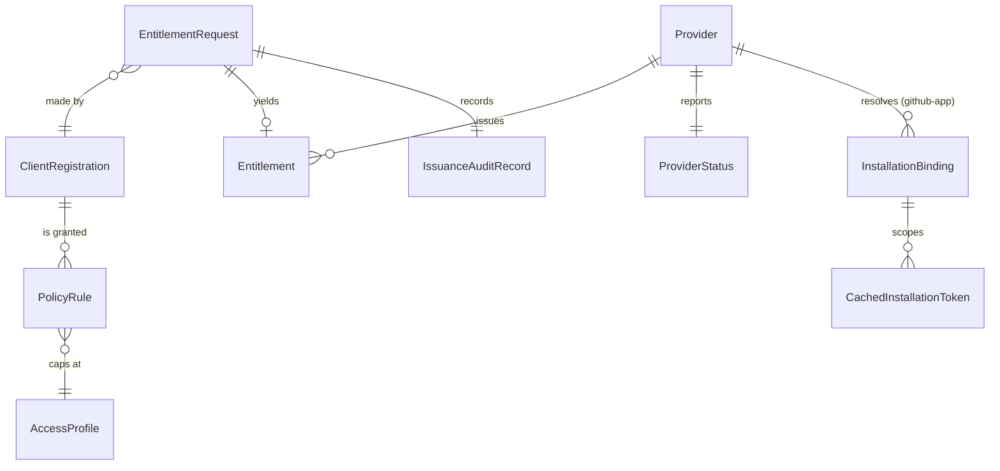
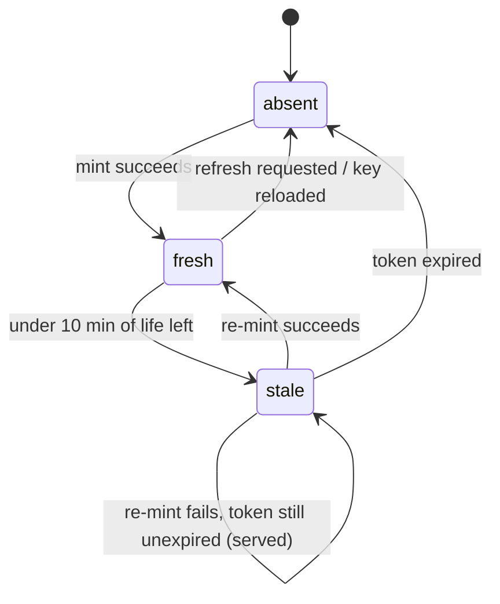

# Data Model: Tessera Credential Entitlement Service
<!-- applicability: code-shaped features only -->

Tessera owns every entity below. Nothing here is stored in Herald, Brood, or the
event log. The only durable state is the secret store and the two operator-owned
config files; everything else is in memory or a log event.

## Entities
<!-- audience: builder; mode: reference; length: tables only; diagram: required; examples: recommended; applicability: code-shaped features only -->

### 1) Client Registration (`TESSERA_CLIENT_KEYS_FILE`)

| Field | Type | Required | Notes |
|-------|------|----------|-------|
| `client` | string | Yes | Stable caller name: `herald`, `brood`, `hatchery`, `legate`, `statio`, `steward`. |
| `key_sha256` | hex string | Yes | SHA-256 of the client's bearer key. The plaintext key is never stored by Tessera. |

Validation rules:
- `client` matches `^[a-z][a-z0-9-]{0,31}$` and is unique in the file.
- `key_sha256` is 64 lowercase hex characters and is unique in the file (two clients may not share a key).
- An empty or missing file is a startup failure, not "allow all".

### 2) Policy Rule (`TESSERA_POLICY_FILE`)

| Field | Type | Required | Notes |
|-------|------|----------|-------|
| `client` | string | Yes | Must name a Client Registration. |
| `identities` | `("app" \| "user")[]` | Yes | Identities the client may request. |
| `repos` | string[] | Yes for `app` | Allowlist of `owner/name` entries; `owner/*` allows every repo of one owner. No bare `*`. |
| `max_access` | `"read" \| "write"` | Yes | Ceiling for the `app` identity (level set pending SD-005). |

Validation rules:
- A client with no rule, or a request outside its rule, is denied (default deny).
- A rule naming an unknown client is a startup failure.
- `user` may appear in `identities` only for the `legate` client in v1; any other client listing it is a startup failure.

Suggested v1 policy (example):

| client | identities | repos | max_access |
|--------|-----------|-------|------------|
| `herald` | app | registered profile repos | read |
| `brood` | app | registered profile repos | read |
| `hatchery` | app | registered profile repos | read |
| `statio` | app | registered profile repos | read |
| `steward` | app | registered profile repos | write |
| `legate` | app, user | registered profile repos | write |

### 3) Access Profile (fixed, in code)

| Level | GitHub App permissions requested |
|-------|----------------------------------|
| `read` | `metadata:read`, `contents:read`, `pull_requests:read`, `issues:read`, `checks:read`, `statuses:read` |
| `write` | everything in `read`, plus `contents:write`, `pull_requests:write`, `issues:write` |

Validation rules:
- `write` does not include `administration` or `members`. Whether `workflows` is excluded, offered as a separate opt-in level, or included is open as spec SD-005; the v1 default excludes it pending that decision.
- The profile is the only source of the `permissions` object sent to GitHub; callers cannot name permissions.

### 4) Entitlement Request (transient)

| Field | Type | Required | Notes |
|-------|------|----------|-------|
| `identity` | `"app" \| "user"` | Yes | Which credential to issue. |
| `repo` | `owner/name` | Yes for `app` | Single repository. Ignored for scoping on `user` (the PAT cannot be downscoped) but recorded in the audit record when present. |
| `access` | `"read" \| "write"` | Yes | Requested level; must not exceed the client's `max_access` (level set pending SD-005). |
| `refresh` | boolean | No | Evicts the matching cache entry before issuing. Default `false`. |
| `subject` | string | No | Reserved for the per-spawn ticket seam. Accepted and audited, never used for a decision in v1. |

Validation rules:
- `repo` matches `^[A-Za-z0-9_.-]+/[A-Za-z0-9_.-]+$`.
- Unknown fields are rejected.

### 5) Entitlement (transient response)

| Field | Type | Required | Notes |
|-------|------|----------|-------|
| `token` | string | Yes | Installation token (`app`) or the operator PAT (`user`). |
| `expires_at` | RFC 3339 string \| null | Yes | `null` only when a `user` token's expiry is not discoverable. |
| `identity` | string | Yes | Login the token acts as: `<app-slug>[bot]` or the operator login. |
| `commit_identity` | `{ name, email }` \| null | Yes | `app` only: `<app-slug>[bot]` and `<bot-user-id>+<app-slug>[bot]@users.noreply.github.com`. `null` for `user`. |
| `access` | `"read" \| "write"` | Yes | Level actually granted. |
| `repo` | `owner/name` \| null | Yes | Repository the token is scoped to; `null` for `user`. |

### 6) Provider (in code, configured by env)

| Field | Type | Required | Notes |
|-------|------|----------|-------|
| `id` | `"github-app" \| "github-user"` | Yes | One per identity in v1. |
| `identity` | `"app" \| "user"` | Yes | The request `identity` it serves. |
| `configured` | boolean | Yes | False when its secret or id is absent; requests then fail with `provider_unconfigured`. |
| `login` | string \| null | Yes | Derived from GitHub at startup, never configured by hand. |

### 7) Installation Binding (in memory)

| Field | Type | Required | Notes |
|-------|------|----------|-------|
| `owner` | string | Yes | Repository owner. |
| `installation_id` | integer | Yes | From `TESSERA_GITHUB_INSTALLATION_ID` when set, else resolved from GitHub per owner. |

### 8) Cached Installation Token (in memory)

| Field | Type | Required | Notes |
|-------|------|----------|-------|
| `installation_id` | integer | Yes | Cache key part 1. |
| `repos` | sorted string[] | Yes | Cache key part 2. Always one repo in v1. |
| `permissions` | Access Profile level | Yes | Cache key part 3. |
| `token` | string | Yes | Never logged, never written to disk. |
| `expires_at` | timestamp | Yes | From GitHub's mint response. |

### 9) Provider Status (in memory, exposed on `/status`)

| Field | Type | Required | Notes |
|-------|------|----------|-------|
| `provider` | Provider id | Yes | |
| `state` | `"ok" \| "unconfigured" \| "degraded" \| "invalid"` | Yes | `degraded`: last GitHub call failed; `invalid`: GitHub rejected the credential. |
| `login` | string \| null | Yes | |
| `credential_expires_at` | RFC 3339 string \| null | Yes | PAT expiry when discoverable; `null` for the app key. |
| `expiry_warning` | boolean | Yes | True when `credential_expires_at` is within 14 days. |
| `last_error` | string \| null | Yes | Error class only; no token or key material. |

### 10) Issuance Audit Record (log event)

| Field | Type | Required | Notes |
|-------|------|----------|-------|
| `caller` | client name | Yes | `unknown` for an unauthenticated request. |
| `identity` | `"app" \| "user"` \| null | Yes | `null` when the request was rejected as `unauthorized` or `invalid_request` before the field could be resolved. |
| `provider` | Provider id \| null | Yes | `null` when no provider was reached (`unauthorized`, `invalid_request`, `policy_denied`, or no provider configured for the identity). |
| `repo` | `owner/name` \| null | Yes | |
| `access` | `"read" \| "write"` \| null | Yes | `null` as for `identity`. |
| `outcome` | `"issued" \| "denied" \| "failed"` | Yes | |
| `reason` | error code \| null | Yes | Set when `outcome` is not `issued`. |
| `cache` | `"hit" \| "miss" \| "n/a"` | Yes | |
| `expires_at` | RFC 3339 string \| null | Yes | |
| `subject` | string \| null | Yes | Echo of the reserved request field. |

Validation rules:
- No field carries a token, a key, a key hash, or a request header.

### 11) Spawn Ticket (future work — not built in v1)

| Field | Type | Required | Notes |
|-------|------|----------|-------|
| `ticket` | string | Yes | Minted by Hatchery for one session. |
| `repo` | `owner/name` | Yes | The slice's repository. |
| `session_id` | string | Yes | Lifetime bound to the session. |
| `expires_at` | timestamp | Yes | |

## Relationships
<!-- audience: builder; mode: reference; length: tables only; diagram: required; examples: recommended; applicability: code-shaped features only -->

- Client Registration 1:N Policy Rule via `client`.
- Policy Rule N:1 Access Profile via `max_access`.
- Provider (`github-app`) 1:N Installation Binding via `owner`.
- Installation Binding 1:N Cached Installation Token via `installation_id`.
- Entitlement Request 1:1 Issuance Audit Record (every request, including denials).
- Entitlement Request 1:0..1 Entitlement (none on denial or failure).
- Provider 1:1 Provider Status.

## State Transitions
<!-- audience: builder; mode: reference; length: tables only; diagram: required; examples: recommended; applicability: code-shaped features only -->

### Cached Installation Token lifecycle

1. `absent` → `fresh`
   - Trigger: an allowed request with no matching cache entry.
   - Effects: one mint call to GitHub; audit `cache: miss`.
2. `fresh` → `stale`
   - Trigger: fewer than 10 minutes remain before `expires_at`.
   - Effects: the next request re-mints instead of reusing.
3. `stale` → `fresh`
   - Trigger: re-mint succeeds.
   - Effects: entry replaced; audit `cache: miss`.
4. `stale` → `stale`
   - Trigger: re-mint fails while the old token is unexpired.
   - Effects: old token served; provider state `degraded`; errored span.
5. `fresh` | `stale` → `absent`
   - Trigger: expiry, `refresh: true`, or the app key file changing.
   - Effects: entry dropped.

### Provider Status lifecycle

1. `unconfigured` → `ok`
   - Trigger: secret present and GitHub confirms the identity at startup or reload.
2. `unconfigured` → `degraded`
   - Trigger: secret present but the startup or reload identity lookup fails with a network error or 5xx.
   - Effects: login is `null`; requests for that identity fail with `provider_unavailable` until a later call succeeds.
3. `ok` → `degraded`
   - Trigger: a GitHub call fails with a network error or 5xx.
4. `degraded` → `ok`
   - Trigger: the next GitHub call succeeds.
5. `ok` | `degraded` → `invalid`
   - Trigger: GitHub rejects the credential (401), or the PAT is past its expiry.
   - Effects: requests for that identity fail with `credential_invalid`.
6. `invalid` → `ok`
   - Trigger: the operator replaces the secret and Tessera reloads it.

## Identity & Uniqueness
<!-- audience: builder; mode: reference; length: tables only; diagram: optional; examples: recommended; applicability: code-shaped features only -->

- A caller is identified only by the SHA-256 of its bearer key; `client` names are unique.
- A cache entry is unique per (`installation_id`, sorted `repos`, `permissions`).
- An Installation Binding is unique per `owner`.
- The bot login and commit identity are derived from GitHub once per start or key reload; they are never configured.
- Audit records have no id; they are ordered by log timestamp and correlated by trace id.
