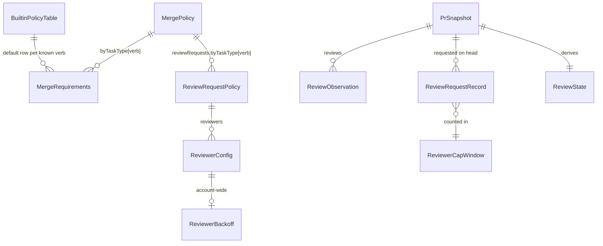

# Data Model: Legate Per-Verb Review Requests and Merge Gates
<!-- applicability: code-shaped features only -->

| Entity | Owner | Durable store |
|---|---|---|
| Merge Requirements, Review Request Policy | Merge policy module (pure) | Herald profile registry `merge_policy` JSON column (existing) |
| Built-in Policy Table | Merge policy module | Code constant |
| Review Observation | Herald sensing (policy-free) | PR snapshot inside `slice.pr.changed` (existing event) |
| Review Request Record | Legate | Herald event log: `review.requested` (new) |
| Reviewer Back-off | Legate | Herald event log: `review.backoff` (new) |
| Review State | Shared pure derivation | Not stored, derived |
| Reviewer Cap Window | Legate | Not stored, derived from `review.requested` |

## Entities
<!-- audience: builder; mode: reference; length: tables only; diagram: required; examples: recommended; applicability: code-shaped features only -->

### 1) Merge Requirements (`merge_policy.byTaskType[verb]`, `merge_policy.defaults`)

| Field | Type | Required | Notes |
|-------|------|----------|-------|
| `approval` | boolean | Resolved: yes; stored: no | An approval is required. |
| `changesRequested` | boolean | Resolved: yes; stored: no | No outstanding human or allowlisted-bot CHANGES_REQUESTED. |
| `botApproval` | boolean | Resolved: yes; stored: no | An allowlisted bot approval on the head commit satisfies `approval`. Existing field from #577. |
| `botApprovers` | string[] | No | New. Allowlist of bot logins, normalised by stripping `[bot]` and lower-casing. The final resolution step (entity 3) fills an empty allowlist when `botApproval` is true. |

Validation rules:
- Only known keys. Booleans must be booleans, and `botApprovers` must be an array of 1–10 non-empty strings matching `^[A-Za-z0-9-]+(\[bot\])?$`.
- `botApprovers` must not contain March's own bot login (`MARCH_SELF_BOT_LOGIN`, default `march-bot`), compared after normalisation.
- Reserved keys `__proto__`, `constructor` and `prototype` are rejected, as today.

### 2) Review Request Policy (`merge_policy.reviewRequests.byTaskType[verb]`)

| Field | Type | Required | Notes |
|-------|------|----------|-------|
| `reviewers` | ReviewerConfig[] | Yes | May be empty, which turns requests off for the verb. |
| `reviewers[].id` | `"coderabbit" \| "copilot"` | Yes | Closed enum, also used as a metric label. |
| `reviewers[].mode` | `"comment-trigger" \| "auto"` | No | CodeRabbit only. Defaults to `comment-trigger`. Copilot is always requested through the API. |

Validation rules:
- Unknown reviewer ids and modes are rejected. A reviewer id appears at most once per verb.
- `mode` set on `copilot` is rejected.

### 3) Built-in Policy Table (code constant)

| Verb | approval | changesRequested | botApproval | botApprovers | reviewers |
|------|----------|------------------|-------------|--------------|-----------|
| `cut` | false | true | false | [] | [] |
| `forge` | true | true | true | `["coderabbitai"]` | [] (opt-in per profile) |
| `spark` | true | true | false | [] | [] |
| `ignite` | true | true | false | [] | [] |
| `render` | true | true | false | [] | [] |
| `mark` | true | true | false | [] | [] |
| `fix` | true | true | false | [] | [] |
| `strike` | true | true | false | [] | [] |
| unknown or none | true | true | false | [] | [] (fixed; not overridable through `defaults`) |

Resolution rules:
- **Known verb**: start from the built-in row, then apply the profile's `byTaskType[verb]` field by field. Profile `defaults` is ignored.
- **Profile-added verb** (named in profile `byTaskType` but not in the table): start from all-required, apply profile `defaults`, then apply profile `byTaskType[verb]`.
- **Unknown or none**: use the fixed fail-closed row.
- **Final step (all branches)**: if `botApproval` is true and `botApprovers` is empty, set `botApprovers` to the built-in allowlist `["coderabbitai"]`. If `botApproval` is false, set `botApprovers` to `[]`.

### 4) Review Observation (`slice.pr.changed` → `pr.reviews[]`)

| Field | Type | Required | Notes |
|-------|------|----------|-------|
| `login` | string | Yes | Normalised: `[bot]` stripped, lower-cased. |
| `author_kind` | `"human" \| "bot"` | Yes | Sensed kind. The legate refines it to allowlisted-bot or other-bot using policy. |
| `state` | `"APPROVED" \| "CHANGES_REQUESTED" \| "COMMENTED" \| "DISMISSED"` | Yes | The login's latest meaningful verdict, chosen with the existing rule. |
| `commit_sha` | string \| null | Yes | The commit the review was submitted on. |
| `submitted_at` | ISO-8601 string | Yes | |

Plus the snapshot additions:

| Field | Type | Notes |
|-------|------|-------|
| `pr.is_draft` | boolean | Used by the request trigger. |
| `pr.reviewer_notices[]` | `{reviewer, kind: "status"\|"in_progress"\|"rate_limited"\|"paused", reset_at?, created_at, commit_sha?}` | Classified reviewer comments, removed from `conversation_comments`. A `rate_limited` notice maps to back-off cause `rate_limited_comment`, a `paused` notice to `paused_comment`. Both derive review state `rate_limited`. |

The existing counts (`human_approval_count`, `bot_approval_count`, `changes_requested_count`) stay for back-compat. The gate uses `reviews[]`.

Validation rules:
- March's own bot login is never written to `reviews[]`.

### 5) Review Request Record (event `review.requested`)

| Field | Type | Required | Notes |
|-------|------|----------|-------|
| `sliceId` | string | Yes | Lets the fold attach the record to the slice. |
| `pr` | integer | Yes | PR number. |
| `reviewer` | `"coderabbit" \| "copilot"` | Yes | |
| `headSha` | string | Yes | 40-hex commit. |
| `at` | ISO-8601 UTC string | Yes | Legate-written. The cap windows bucket on this. |
| `reason` | `"initial" \| "stale_approval" \| "stale_changes_requested" \| "timeout_retry"` | Yes | |

Envelope `profile` is set by the legate.

Validation rules:
- `POST /events` rejects unknown `reviewer` and `reason` values and a non-hex `headSha`.

### 6) Reviewer Back-off (event `review.backoff`)

| Field | Type | Required | Notes |
|-------|------|----------|-------|
| `reviewer` | `"coderabbit" \| "copilot"` | Yes | Account-wide key. |
| `until` | ISO-8601 UTC string | Yes | A stated reset time, or now plus the exponential back-off. On a reset, the time of the reset, so the reviewer is immediately eligible. |
| `attempts` | integer ≥ 0 | Yes | Consecutive rate-limited or failed attempts. `0` only on a reset. |
| `cause` | `"http_429" \| "rate_limited_comment" \| "paused_comment" \| "post_failed" \| "reset"` | Yes | `reset` is appended after a review lands on the head while attempts were above 0. |

The envelope `profile` is the profile that observed it, but the record applies across profiles.

Validation rules:
- `cause: "reset"` if and only if `attempts == 0`. Every other cause requires `attempts ≥ 1`.
- The latest record per reviewer wins on rebuild, so a reset clears the back-off after a restart.

### 7) Review State (derived)

| Value | Condition (first match wins) |
|-------|------------------------------|
| `changes_requested` | An allowlisted bot or a human has CHANGES_REQUESTED as their latest verdict |
| `approved_by_bot` | An allowlisted bot approved on `head_sha` |
| `rate_limited` | A configured reviewer is in back-off and has no review on the head |
| `in_progress` | A reviewer `in_progress` notice is less than `REVIEW_WAIT` old on the head |
| `requested` | A `review.requested` record on the head, less than `REVIEW_WAIT` old |
| `none` | Otherwise |

### 8) Reviewer Cap Window (derived)

| Field | Type | Notes |
|-------|------|-------|
| `reviewer` | enum | |
| `window` | `"day" \| "month"` | UTC calendar buckets. |
| `used` | integer | Count of `review.requested` for the reviewer with `at` in the current bucket, across all profiles. |
| `limit` | integer \| null | `MARCH_COPILOT_REVIEWS_PER_DAY` / `_PER_MONTH` (default 0), `MARCH_CODERABBIT_REVIEWS_PER_DAY` (default null = unlimited). |
| `remaining` | integer \| null | `max(0, limit − used)`. |

## Relationships
<!-- audience: builder; mode: reference; length: tables only; diagram: required; examples: recommended; applicability: code-shaped features only -->

- A Merge Policy holds 0..N Merge Requirements entries, keyed by verb, and 0..N Review Request Policy entries, keyed by verb.
- A Built-in Policy Table row supplies the default for each known verb.
- A PR snapshot has 0..N Review Observations, at most one per normalized login and author kind.
- A PR has 0..N Review Request Records, each keyed by (`pr`, `reviewer`, `headSha`, `at`).
- A reviewer has 0..1 current Reviewer Back-off, global across profiles. It is the latest `review.backoff` for that reviewer in any profile's fold.
- Reviewer Cap Window N:1 Review Request Record: a window counts the records whose `at` falls in it.

## State Transitions
<!-- audience: builder; mode: reference; length: tables only; diagram: required; examples: recommended; applicability: code-shaped features only -->

### Review request lifecycle, per (PR, reviewer, head)

| From | To | Trigger | Effects |
|------|----|---------|---------|
| `eligible` | `requested` | Trigger conditions met (FR-017) | Append `review.requested`, then post the request. Span outcome `requested`. |
| `requested` | `in_progress` | Reviewer in-progress notice sensed on the head | None |
| `requested` / `in_progress` | `reviewed` | Review Observation with `commit_sha == head` | Back-off attempts reset |
| `requested` / `in_progress` | `eligible` | `REVIEW_WAIT` elapsed with no review on the head | The next request carries `reason: timeout_retry` |
| `requested` | `backoff` | Post returns 429 or fails, or a rate-limited/paused notice | Append `review.backoff`. Span outcome `backoff` (429/notice) or `failed` (post failed, errored) |
| `backoff` | `eligible` | `now ≥ until` | None |
| any | `refused` | Cap exhausted, or the Copilot identity is unavailable | No post. Errored span with outcome `cap_exhausted` or `identity_unavailable` |
| `requested` / `in_progress` | `eligible` (new head) | New head before any verdict from the reviewer on this PR | The next request carries `reason: initial` |
| `reviewed` | `eligible` (new head) | New head **and** (stale approval with approval the only unmet gate, **or** a stale bot CHANGES_REQUESTED with threads resolved) | `reason: stale_approval` / `stale_changes_requested` |

## Identity & Uniqueness
<!-- audience: builder; mode: reference; length: tables only; diagram: optional; examples: recommended; applicability: code-shaped features only -->

- Request idempotency key: `review:<profile>:<pr>:<reviewer>:<headSha>`. A record younger than `REVIEW_WAIT` suppresses another request.
- Back-off key: `reviewer`, global across profiles.
- Cap windows: `(reviewer, UTC day)` and `(reviewer, UTC month)`, counted across all profiles.
- Review Observation key: `(pr, normalised login, author kind)`.
- Bot identity: normalised login, plus `author_kind == bot`. A human account named like a bot never matches the allowlist.
