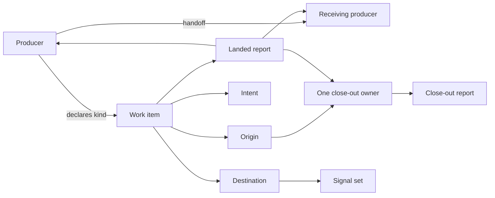
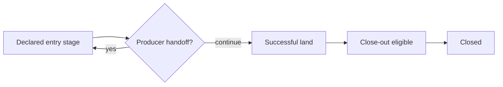

# Data Model: Published Work Module Contract
<!-- applicability: code-shaped features only -->

**Source RFC**: [RFC 2026-004](../../docs/rfcs/2026-004-work-modules/work-modules.rfc.md)\
**Source Feature Map**: [Feature 1](../../docs/rfcs/2026-004-work-modules/01-module-contract-v1-loader-and-conformance-kit.features.md#feature-1-published-work-module-contract)

## Entities
<!-- audience: builder; mode: reference; length: tables only; diagram: required; examples: recommended; applicability: code-shaped features only -->

| Entity | Required fields | Optional fields | Validation |
|--------|-----------------|-----------------|------------|
| Module definition | Module ID, contract version, role, observe and act facet declarations | Producer aliases and responder registrations | Producers declare their canonical kinds. Aliases resolve to exactly one canonical kind. |
| Work item | Item ID, current producer, canonical kind, origin, destination instance, entry stage, close-out owner | Artifact reference, steward reference | Origin identifies its source and source object. Exactly one bound module serving that origin is the close-out owner. Stages are discover, implement, steward, land and close out. |
| Producer handoff | Predecessor item ID, receiving producer, successor kind, proposed destination and entry stage | Artifact reference | The successor uses a kind declared by the receiving producer. The predecessor supplies the immutable origin and close-out owner. |
| Signal set | Item ID, reporting destination, checks, comments, approvals | Provider-specific opaque references in individual signals | Checks carry status and a platform or user mark. The platform pair is mandatory. Comments distinguish review threads and conversation comments. Approval state feeds the merge gate. |
| Intent | Item ID, step discriminator, discriminated step inputs | — | Each discriminator has one fixed destructive class from the contract. Producers and destinations may request only module-eligible steps. |
| Landed report | Item ID, destination, landed artifact reference | — | Reports a successful land outcome from core execution. |
| Close-out report | Item ID, origin, owner, outcome | Diagnostic for failure | The owner matches the item's close-out owner. Failure requires a diagnostic. An already-completed origin can be reported as such on replay. |

## Relationships
<!-- audience: builder; mode: reference; length: tables only; diagram: required; examples: recommended; applicability: code-shaped features only -->

## State Transitions
<!-- audience: builder; mode: reference; length: tables only; diagram: required; examples: recommended; applicability: code-shaped features only -->

| Transition | Trigger | Contract effect |
|------------|---------|-----------------|
| Enter at a declared stage | Producer discovers or receives work | Earlier stages may be skipped, and the item's origin and owner are present at entry. |
| Hand off to another producer | Core accepts a handoff proposal | The receiving producer supplies its own kind and instructions. The origin, close-out owner and record of participating producers survive. |
| Land → close-out eligible | Successful execution of a land intent | Core delivers the landed report to the origin owner and participating producers. |
| Close-out eligible → closed | Successful close-out by core for the origin owner | Outcome identifies the original source object. Later reports for the same origin do not cause a second close. |
| Actionable signal → needs-human | Core finds no registered responder | The contract calls for an escalation outcome. |

## Identity & Uniqueness
<!-- audience: builder; mode: reference; length: tables only; diagram: optional; examples: recommended; applicability: code-shaped features only -->

- Work reports and intents correlate by core work-item ID. The origin reference is stable across producer handoffs and provides the scope for once-per-origin close-out.
- Canonical kinds are producer-namespaced. The bare Smithy verbs `cut`, `forge`, `spark`, `ignite`, `render`, `mark`, `fix` and `strike` resolve to the corresponding `smithy/<verb>` kinds during migration.
- Item identity, persistence, and replay mechanics belong to the lifecycle feature. The public model requires stable correlation and carries no storage schema.
